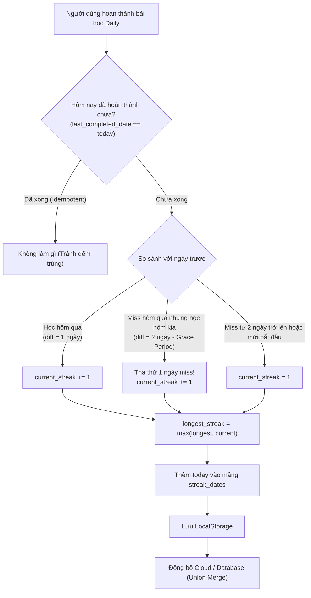

# TÀI LIỆU TOÀN DIỆN VỀ KIẾN TRÚC & LOGIC HỆ THỐNG STREAK (STREAK SYSTEM & STREAK GARDEN)

> Tài liệu này được trích xuất và chuẩn hóa từ hệ thống thực tế của ứng dụng **Deutsch C1**. Bạn có thể dùng tài liệu này làm đặc tả kỹ thuật (Technical Spec) để lập trình cho bất kỳ ứng dụng nào khác (Mobile App Flutter/React Native, Web App Next.js/Vue, hoặc Backend Node.js/Go/Python/Java).

---

## MỤC LỤC
1. [Tổng Quan Kiến Trúc (Architecture Overview)](#1-tổng-quan-kiến-trúc)
2. [Thiết Kế Cơ Sở Dữ Liệu (Database Schemas)](#2-thiết-kế-cơ-sở-dữ-liệu)
3. [Quy Tắc Nghiệp Vụ Cốt Lõi (Core Business Rules)](#3-quy-tắc-nghiệp-vụ-cốt-lõi)
4. [Thuật Toán Tính & Tự Phục Hồi Streak (Self-Healing Engine)](#4-thuật-toán-tính--tự-phục-hồi-streak)
5. [Đồng Bộ Đa Thiết Bị & Offline-First (Sync Strategy)](#5-đồng-bộ-đa-thiết-bị--offline-first)
6. [Hệ Thống Gamification: Vườn Cây Streak (Streak Garden)](#6-hệ-thống-gamification-vườn-cây-streak)
7. [Mã Nguồn Mẫu Hoàn Chỉnh (TypeScript Reference Implementation)](#7-mã-nguồn-mẫu-hoàn-chỉnh)

---

## 1. TỔNG QUAN KIẾN TRÚC

Hệ thống Streak này kết hợp 2 mô hình dữ liệu:
1. **State Snapshot (`user_streak`)**: Lưu trạng thái hiện tại để đọc siêu nhanh (O(1)) khi render Dashboard.
2. **Audit Trail / Event Log (`streak_dates`)**: Danh sách mảng các ngày đã hoàn thành (`["YYYY-MM-DD", ...]`). Đây là **Single Source of Truth** (Chân lý gốc) dùng để tự sửa lỗi (Self-healing) và dựng lịch sử đồ họa vườn cây.



---

## 2. THIẾT KẾ CƠ SỞ DỮ LIỆU

### 2.1. Cấu trúc NoSQL / Firebase (Mô hình Deutsch C1 đang dùng)
```json
{
  "user_streak": {
    "current_streak": 16,
    "longest_streak": 25,
    "last_completed_date": "2026-10-25"
  },
  "user_stats": {
    "streak_dates": [
      "2026-10-01",
      "2026-10-02",
      "2026-10-03",
      "2026-10-05",
      "2026-10-25"
    ],
    "streak_missed_days": 2,
    "last_active_date": "2026-10-25"
  }
}
```

### 2.2. Cấu trúc SQL (PostgreSQL / MySQL)
```sql
-- Bảng lưu trạng thái tổng quan của người dùng
CREATE TABLE user_streaks (
    user_id VARCHAR(64) PRIMARY KEY,
    current_streak INT DEFAULT 0,
    longest_streak INT DEFAULT 0,
    last_completed_date DATE NULL,
    updated_at TIMESTAMP DEFAULT CURRENT_TIMESTAMP
);

-- Bảng lưu log các ngày hoàn thành (Audit log)
CREATE TABLE user_streak_logs (
    id BIGSERIAL PRIMARY KEY,
    user_id VARCHAR(64) NOT NULL,
    completed_date DATE NOT NULL,
    created_at TIMESTAMP DEFAULT CURRENT_TIMESTAMP,
    UNIQUE(user_id, completed_date) -- Đảm bảo tính Idempotent
);
```

### 2.3. Cấu trúc MongoDB
```json
{
  "_id": "user_12345",
  "streak": {
    "current": 16,
    "longest": 25,
    "last_completed_date": "2026-10-25"
  },
  "streak_dates": [
    "2026-10-01",
    "2026-10-02",
    "2026-10-03",
    "2026-10-05"
  ]
}
```

---

## 3. QUY TẮC NGHIỆP VỤ CỐT LÕI (CORE BUSINESS RULES)

### Quy tắc 1: Tính Bất Biến Trong Ngày (Idempotency)
- Một ngày người dùng có thể làm bài 10 lần, nhưng chuỗi Streak **chỉ được tăng đúng 1 lần**.
- Điều kiện kiểm tra:
  ```javascript
  if (streak.last_completed_date === todayStr) {
      return; // Không tăng thêm
  }
  ```

### Quy tắc 2: Cơ Chế Tha Thứ 1 Ngày (1-Day Grace Period / Streak Freeze Tự Động)
- Đây là điểm mấu chốt tâm lý học: Nếu bắt người dùng cày lại từ số 0 chỉ vì quên 1 ngày bận việc, tỉ lệ bỏ app lên đến 70%.
- **Quy tắc**:
  - Học liên tục (cách 1 ngày): `current_streak += 1`
  - Bỏ lỡ đúng 1 ngày (cách 2 ngày): **VẪN ĐƯỢC CỘNG TIẾP** `current_streak += 1` (ngày bị lỡ được tự động tha thứ).
  - Bỏ lỡ từ 2 ngày trở lên (cách 3+ ngày): Reset về `1` (bắt đầu lại chuỗi mới từ ngày hôm nay).

### Quy tắc 3: Kiểm Tra Reset Khi Mở App (Passive Expiration)
- Khi người dùng mở app lên mà chưa học gì cả, app phải kiểm tra xem streak có bị hết hạn hay không:
  ```javascript
  const diffDays = Math.floor((today - lastDate) / (1000 * 60 * 60 * 24));
  // Nếu đã quá 2 ngày không học, streak hiển thị trên UI phải về 0
  if (diffDays > 2) {
      streak.current_streak = 0;
  }
  ```

---

## 4. THUẬT TOÁN TÍNH & TỰ PHỤC HỒI STREAK (SELF-HEALING ENGINE)

Nếu người dùng xóa cache, đổi máy, hoặc dữ liệu `current_streak` bị lệch với lịch sử thực tế, hàm `recalculateStreakFromDates` sẽ quét mảng `streak_dates` để tính lại streak chuẩn xác 100%:

```javascript
function recalculateStreakFromDates(streakDates) {
  if (!streakDates || streakDates.length === 0) return 0;

  // 1. Sắp xếp chuỗi ngày tăng dần
  const sorted = [...streakDates].sort();

  // 2. Duyệt qua từng mốc ngày
  let calculatedStreak = 1;
  for (let i = 1; i < sorted.length; i++) {
    const prev = new Date(sorted[i - 1]);
    const curr = new Date(sorted[i]);
    const diffDays = Math.round((curr - prev) / (1000 * 60 * 60 * 24));

    if (diffDays === 1) {
      // Ngày liên tiếp -> tăng bình thường
      calculatedStreak++;
    } else if (diffDays === 2) {
      // Miss đúng 1 ngày -> Grace Period được tha thứ -> vẫn tăng
      calculatedStreak++;
    } else {
      // Miss từ 2 ngày trở lên -> đứt chuỗi, bắt đầu lại từ 1
      calculatedStreak = 1;
    }
  }

  return calculatedStreak;
}
```

---

## 5. ĐỒNG BỘ ĐA THIẾT BỊ & OFFLINE-FIRST

Để người dùng học khi offline (trên máy bay, mất mạng) mà khi online không bị ghi đè mất ngày cũ:

### Chiến Lược "Union Merge" (Hợp Hai Tập Hợp)
Khi tải dữ liệu từ máy chủ về hoặc lưu lên máy chủ:
```javascript
const localDates = JSON.parse(localStorage.getItem('streak_dates')) || [];
const remoteDates = serverData.streak_dates || [];

// Lấy hợp (Set) để loại bỏ trùng lặp và giữ toàn bộ lịch sử
const mergedDates = [...new Set([...remoteDates, ...localDates])].sort();

// Không bao giờ có trường hợp bị mất ngày của một máy khác!
localStorage.setItem('streak_dates', JSON.stringify(mergedDates));
```

---

## 6. HỆ THỐNG GAMIFICATION: VƯỜN CÂY STREAK (STREAK GARDEN)

Đây là tính năng biến các con số khô khan thành giao diện trực quan sinh động.

### 6.1. Bảng Phân Bậc Milestone (Tiers)
Khi người dùng học được nhiều ngày, hệ thống sẽ **gộp các ngày liên tiếp** thành các biểu tượng cao cấp hơn thay vì vẽ hàng trăm hạt mầm:

| Bậc (Tier) | Ngày Học (Healthy) | Tên Biểu Tượng | Ngày Bỏ Lỡ (Dead) | Tên Biểu Tượng |
| :--- | :--- | :--- | :--- | :--- |
| **100** | 💖 `100d` | Trái tim kim cương (Heart) | 👻 `100m` | Hồn ma (Ghost) |
| **15** | 🍑 `15d` | Trái cây cao cấp (Fruit) | ☠️ `15m` | Đầu lâu (Skull) |
| **10** | 🌸 `10d` | Bông hoa nở (Flower) | 🪵 `10m` | Khúc gỗ khô (Log) |
| **5** | 🌳 `5d` | Cây đại thụ (Tree) | 🍂 `5m` | Lá rụng (Dead leaf) |
| **1** | 🌱 `1d` | Mầm non (Sprout) | 🌾 `1m` | Rơm khô (Straw) |

### 6.2. Thuật Toán Nén Chuỗi Thành Milestone (`compressRun`)
Thuật toán phân rã tham lam (Greedy Tier Decomposition):
```javascript
const tiers = [100, 15, 10, 5];
let remaining = runDaysCount;
const items = [];

for (const tier of tiers) {
  const count = Math.floor(remaining / tier);
  for (let i = 0; i < count; i++) {
    items.push({ type: 'healthy', label: `${tier}d`, tier: tier });
  }
  remaining %= tier;
}

// Số ngày dư còn lại tạo thành mầm 1d
for (let i = 0; i < remaining; i++) {
  items.push({ type: 'healthy', label: '1d', tier: 1 });
}
```

### 6.3. Thuật Toán Sinh Emoji Ổn Định Bằng Băm Chuỗi (Stable Hash Emoji)
Để mỗi lần mở modal, các quả cây không bị nhảy loạn xạ giữa quả đào, dâu tây, táo:
```javascript
function getHashEmoji(pool, seedStr) {
  let hash = 0;
  for (let k = 0; k < seedStr.length; k++) {
    hash = (hash << 5) - hash + seedStr.charCodeAt(k);
    hash |= 0;
  }
  return pool[Math.abs(hash) % pool.length];
}
```

---

## 7. MÃ NGUỒN MẪU HOÀN CHỈNH (TYPESCRIPT REFERENCE IMPLEMENTATION)

Dưới đây là một module độc lập `StreakEngine.ts` bạn có thể import vào bất kỳ dự án mới nào:

```typescript
export interface StreakData {
  current_streak: number;
  longest_streak: number;
  last_completed_date: string; // YYYY-MM-DD
}

export interface GardenItem {
  type: 'healthy' | 'dead';
  emoji: string;
  label: string;
  date?: string;
}

export class StreakEngine {
  private static readonly TIERS = [100, 15, 10, 5];

  private static readonly EMOJI_POOLS: Record<number, string[]> = {
    100: ['❤️', '🧡', '💛', '💚', '💙', '💜', '💖', '💝'],
    15:  ['🍑', '🍓', '🍎', '🍏', '🍐', '🍊', '🍋', '🍒', '🍇', '🍉'],
    10:  ['🌸', '🌷', '🪷', '🌻', '🌹', '🌺', '🌼'],
    5:   ['🌳', '🌲', '🌴', '🎋'],
    1:   ['🌱']
  };

  /**
   * Định dạng Date thành YYYY-MM-DD theo giờ địa phương
   */
  public static formatDate(d: Date): string {
    const year = d.getFullYear();
    const month = String(d.getMonth() + 1).padStart(2, '0');
    const day = String(d.getDate()).padStart(2, '0');
    return `${year}-${month}-${day}`;
  }

  /**
   * Hoàn thành bài học ngày hôm nay (Idempotent)
   */
  public static recordDailyCompletion(currentData: StreakData, streakDates: string[], today = new Date()): {
    updatedStreak: StreakData;
    updatedDates: string[];
    isNewDay: boolean;
  } {
    const todayStr = this.formatDate(today);

    // 1. Kiểm tra Idempotency
    if (currentData.last_completed_date === todayStr) {
      return { updatedStreak: { ...currentData }, updatedDates: streakDates, isNewDay: false };
    }

    const yesterday = new Date(today);
    yesterday.setDate(yesterday.getDate() - 1);
    const yesterdayStr = this.formatDate(yesterday);

    const dayBeforeYesterday = new Date(today);
    dayBeforeYesterday.setDate(dayBeforeYesterday.getDate() - 2);
    const dayBeforeYesterdayStr = this.formatDate(dayBeforeYesterday);

    let nextStreak = currentData.current_streak;

    if (currentData.last_completed_date === yesterdayStr) {
      // Học ngày liền kề
      nextStreak += 1;
    } else if (currentData.last_completed_date === dayBeforeYesterdayStr) {
      // Grace period: bỏ 1 ngày vẫn được nối chuỗi
      nextStreak += 1;
    } else {
      // Miss >= 2 ngày hoặc mới bắt đầu
      nextStreak = 1;
    }

    const updatedStreak: StreakData = {
      current_streak: nextStreak,
      longest_streak: Math.max(currentData.longest_streak, nextStreak),
      last_completed_date: todayStr
    };

    // 2. Thêm vào mảng lịch sử streak_dates
    const dateSet = new Set(streakDates);
    dateSet.add(todayStr);
    const updatedDates = Array.from(dateSet).sort();

    return { updatedStreak, updatedDates, isNewDay: true };
  }

  /**
   * Tính toán icon cây chết dựa trên số ngày bị miss
   */
  public static getDeadIcon(gapDays: number): { emoji: string; label: string } {
    if (gapDays >= 100) return { emoji: '👻', label: `${gapDays}m` };
    if (gapDays >= 15)  return { emoji: '☠️', label: `${gapDays}m` };
    if (gapDays >= 10)  return { emoji: '🪵', label: `${gapDays}m` };
    if (gapDays >= 5)   return { emoji: '🍂', label: `${gapDays}m` };
    return { emoji: '🌾', label: `${gapDays}m` };
  }

  /**
   * Tạo danh sách phần tử cho giao diện Streak Garden
   */
  public static generateGardenItems(streakDates: string[]): GardenItem[] {
    if (!streakDates || streakDates.length === 0) return [];
    const sorted = [...streakDates].sort();
    const gardenItems: GardenItem[] = [];
    let runStart = 0;

    for (let i = 1; i <= sorted.length; i++) {
      const isLast = (i === sorted.length);
      let gapDays = 0;

      if (!isLast) {
        const prev = new Date(sorted[i - 1]);
        const curr = new Date(sorted[i]);
        gapDays = Math.round((curr.getTime() - prev.getTime()) / (1000 * 60 * 60 * 24)) - 1;
      }

      if (gapDays > 0 || isLast) {
        const runDates = sorted.slice(runStart, i);
        let remaining = runDates.length;
        let idx = 0;

        // Nén run thành các tier
        for (const tier of this.TIERS) {
          const count = Math.floor(remaining / tier);
          for (let c = 0; c < count; c++) {
            const repDate = runDates[Math.min(idx + tier - 1, runDates.length - 1)];
            const pool = this.EMOJI_POOLS[tier];
            const emoji = pool[c % pool.length];
            gardenItems.push({ type: 'healthy', emoji, label: `${tier}d`, date: repDate });
            idx += tier;
          }
          remaining %= tier;
        }

        // Ngày lẻ còn lại -> Mầm 1d
        for (let r = 0; r < remaining; r++) {
          gardenItems.push({ type: 'healthy', emoji: '🌱', label: '1d', date: runDates[idx + r] });
        }

        // Thêm cây chết nếu có khoảng trống
        if (gapDays > 0) {
          const dead = this.getDeadIcon(gapDays);
          gardenItems.push({ type: 'dead', emoji: dead.emoji, label: dead.label });
          runStart = i;
        }
      }
    }

    return gardenItems;
  }
}
```

---

## 8. DANH SÁCH FILE LIÊN QUAN TRONG DỰ ÁN DEUTSCH C1
Nếu muốn tham khảo trực tiếp mã nguồn trong dự án này:
- **Dịch vụ Streak & Grace Period**: [`StreakService`](file:///d:/code/deutschc1/app.js#L4054-L4116)
- **Tự phục hồi Streak từ chuỗi ngày**: [`recalculateStreakFromDates`](file:///d:/code/deutschc1/app.js#L4118-L4157)
- **Vườn cây Streak Gamification**: [`openStreakGardenModal`](file:///d:/code/deutschc1/app.js#L3555-L3705)
- **Modal HTML Vườn Cây & Bảng Chú Thích**: [`index.html (Dòng 760-811)`](file:///d:/code/deutschc1/index.html#L760-L811)
- **Hiệu Ứng CSS Nảy Cây Vườn (Pop-in)**: [`.garden-slot in style.css`](file:///d:/code/deutschc1/style.css#L1540-L1566)
